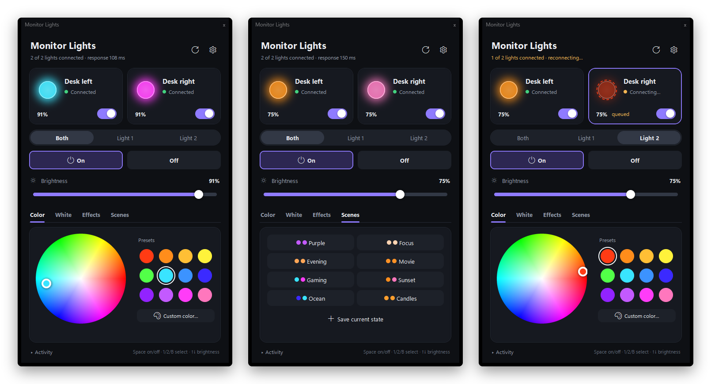
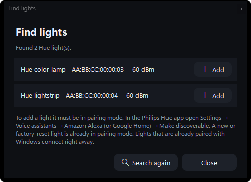
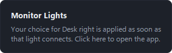

<p align="center"></p>

<h1 align="center">Monitor Lights</h1>

<p align="center">
Control your Philips Hue Bluetooth lights from your Windows PC.<br>
Fast, reliable, and no Hue Bridge needed.
</p>

<p align="center">
<a href="https://github.com/jargyl/monitor-lights/releases/latest"><b>⬇ Download for Windows</b></a>
</p>



## What it does

- **Both lights or one at a time.** Color wheel and presets, whites from candlelight to daylight, brightness, effects (candle, fireplace, sparkle and more) and scenes.
- **Fast.** The Bluetooth connection stays open, so a change reaches the light in about a tenth of a second.
- **Doesn't give up.** Light switched off at the wall, out of range, Windows busy? It reconnects by itself.
- **Set it and forget it.** Pick a color while a light is still unreachable: it is applied the moment the light is back, even if you already closed the window.
- **Command line.** `lights color red`, `lights scene Evening`… for shortcuts, scripts and Stream Deck.
- No account, no cloud, nothing to sign in to.

## Install

1. Download **MonitorLights-Setup-….exe** from the [latest release](https://github.com/jargyl/monitor-lights/releases/latest).
2. Run it. Windows may show *"Windows protected your PC"* because this free app is not code-signed. Click **More info → Run anyway**.
3. Click **Install**, then **Finish**. Monitor Lights opens right away.

No admin rights and no Python needed. Rather not install anything? Download the **portable zip**, extract it and run `Monitor Lights.exe`.

**You need:** Windows 10 or 11 with Bluetooth (built in, or a USB adapter) and Philips Hue lights with Bluetooth.

## Connect your lights

The first time you start Monitor Lights, the **Find lights** window opens by itself.

1. Make sure Bluetooth is on (Windows Settings → Bluetooth & devices).
2. Put your lights in pairing mode: in the **Philips Hue app** on your phone, go to **Settings → Voice assistants → Amazon Alexa** (or Google Home) and tap **Make discoverable**. New or factory-reset lights are already in pairing mode.
3. Click **Add** next to each light. That's it.



Lights that are already paired with Windows connect straight away. To see which light is which, open **Settings** (gear icon) and click **Blink**. You can rename your lights there too.

## Everyday use

- Choose **Both**, **Light 1** or **Light 2**, then a color, white, effect or scene.
- Keyboard: <kbd>Space</kbd> on/off, <kbd>1</kbd> / <kbd>2</kbd> / <kbd>B</kbd> choose the light, <kbd>↑</kbd> <kbd>↓</kbd> brightness.
- Close the window when you're done. If a light was still unreachable, Monitor Lights keeps working invisibly until your choice is applied, and lets you know:



## Command line (optional)

During setup you can tick *Add the 'lights' command to PATH*. Otherwise use `lights.exe` in the install folder (`%LOCALAPPDATA%\Programs\Monitor Lights`).

```
lights on                     lights off -l 2
lights color red              lights color #ff8800 -l 1 -b 60
lights white warm             lights brightness 40
lights effect candle          lights scene Evening
lights status                 lights list
```

When the app is open, commands go through it and are instant. When it isn't, `lights` connects by itself, and whatever it can't deliver in time is handed to Monitor Lights in the background. Run `lights -h` for everything.

## Troubleshooting

| You see | What to do |
|---|---|
| **Bluetooth is off** / **No Bluetooth adapter** | Turn Bluetooth on in Windows Settings, or plug in your USB Bluetooth adapter. |
| **No signal** / **Unreachable** | Is the light powered (wall switch)? Is it close enough? The same room works best. The app keeps trying by itself. |
| **One moment…** | Windows is still closing an earlier connection, for example right after restarting the app. This sorts itself out within about 20 seconds. |
| **In use by another app** | Only one program on a PC can control a light at a time. Close other Hue tools or a second copy of Monitor Lights. |
| **Not paired with Windows** | Remove the light in Windows Settings → Bluetooth & devices, put it in pairing mode again and use **Find lights → Add**. |
| The Hue app on your phone can't connect | In Settings, choose *Release the lights after inactivity*, or click **Release now**. |
| Connections drop often | USB 3 ports and cables disturb Bluetooth. Use a USB 2 port, or a short USB extension cable so the adapter sits away from the PC and in sight of the lights. |
| Your lights are on a Hue Bridge | Bluetooth still works alongside the Bridge. See [these notes from HueBLE](https://hueble.readthedocs.io/en/latest/usage.html) on making such lights discoverable. |

Still stuck? Open **Settings → Open log folder** and attach `controller.log` to a new [issue](https://github.com/jargyl/monitor-lights/issues).

Your lights and settings live in `%APPDATA%\Monitor Lights`. Updating or uninstalling keeps them.

## Run from source

For developers, or if you prefer Python (3.10 or newer):

```
git clone https://github.com/jargyl/monitor-lights.git
cd monitor-lights
install.bat
```

`install.bat` installs the two packages ([bleak](https://github.com/hbldh/bleak) and [Pillow](https://python-pillow.org)) and adds a shortcut to your desktop and Start menu. By hand: `py -m pip install -r requirements.txt`, then `pyw "Monitor Lights.pyw"`. The command line is `py hue_cli.py`.

- Demo without lights: `py hue_controller.py --sim`
- Tests: `py -m unittest discover -s tests -p "test_*.py"`
- Hardware test (changes your lights, restores them at the end): `py tests/hw_test.py`
- Windows app: `py -m PyInstaller packaging/monitor_lights.spec`, installer: [Inno Setup](https://jrsoftware.org/isinfo.php) with `packaging/installer.iss`. GitHub Actions builds and tests both for every push, and publishes them for every version tag.

### How it works

Hue Bluetooth lights have one GATT characteristic that takes power, brightness, color (CIE xy), color temperature, effect and fade time in a single packet. Monitor Lights connects to paired lights directly by address (no scan first) and keeps one connection per light open. A small supervisor per light reconnects with backoff when a connection drops. While you drag a slider only the latest value is sent, and a command for a light that isn't connected waits until it is.

The protocol details come from the open-source [HueBLE](https://github.com/flip-dots/HueBLE) library. Thanks!

## License

[MIT](LICENSE). Not affiliated with or endorsed by Signify or Philips. Philips Hue is a trademark of Signify.
